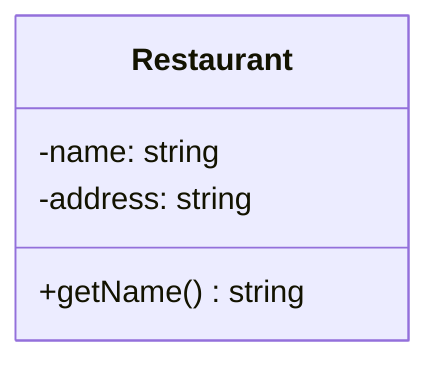

## Step 1

## Step 4

| Line | Will it be underlined in red? Which symbol in the diagrams of Steps 1 and 3 tells you? | The error message |
|---|---|---|
| (a) |yes, «abstract» |Cannot create an instance of an abstract class. |
| (b) |no |no errors |
| (c) |yes, -name: string |Property 'name' is private and only accessible within class 'Customer'. |